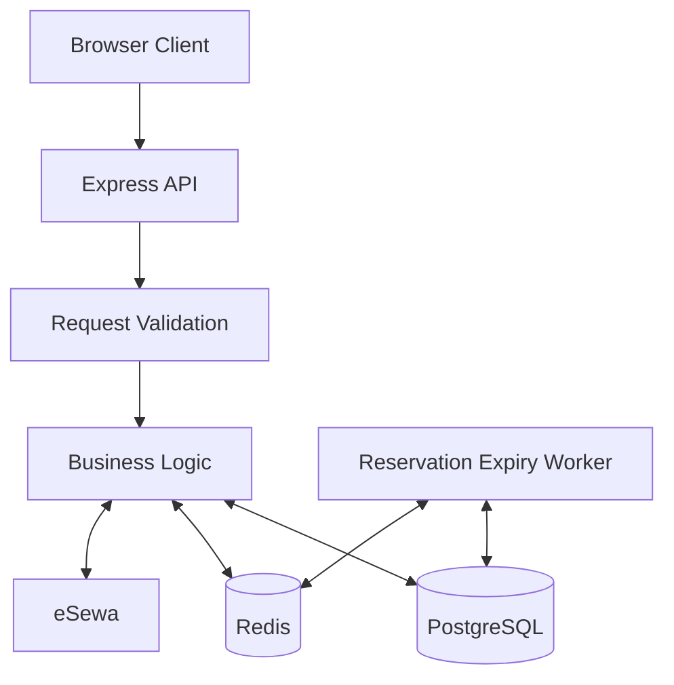

# Movie Ticket Booking API

A movie ticket booking application built with **Node.js, TypeScript, Express 5, Prisma ORM, PostgreSQL, and Redis**. It supports movie and show listings, seat availability, temporary reservations, payment processing, booking confirmation, and automatic reservation expiration.

## Features

- Movie and show listing
- Show-specific seat availability
- Temporary seat reservations
- Cash and eSewa payment flows
- Booking confirmation
- Automatic reservation expiration
- Redis-based seat-map caching
- PostgreSQL transactions and row locking for reservation coordination
- Background worker for expired reservations
- Zod-based request validation

## Tech Stack

- **Runtime:** Node.js
- **Package manager:** npm
- **Language:** TypeScript
- **HTTP framework:** Express 5
- **ORM:** Prisma
- **Database:** PostgreSQL
- **Cache:** Redis
- **Validation:** Zod
- **Payments:** eSewa
- **Frontend:** HTML, CSS, JavaScript

## Architecture

The main booking flow is:

`Movie → Show → Screen → Seat → ShowSeat → Reservation → Payment → Booking`

The API server handles HTTP requests, while a separate worker handles reservation expiration.



### Main components

- `app.ts` — Express application configuration
- `server.ts` — HTTP server startup and graceful shutdown
- `src/routes` — API route definitions and handlers
- `src/routes/modules/*/*.controller.ts` — HTTP request handling
- `src/routes/modules/*/*.service.ts` — business logic
- Worker files — background reservation-expiry processing
- `schema.prisma` — database schema
- `public` — browser frontend assets

## API

The versioned API base path is:

```text
/api/v1
```

### Endpoints

| Method | Endpoint | Purpose |
|---|---|---|
| `GET` | `/` | Application information |
| `GET` | `/health/` | Health check |
| `GET` | `/api/v1/movies` | List movies |
| `GET` | `/api/v1/movies/:movieId/shows` | List shows for a movie |
| `GET` | `/api/v1/shows/:showId/seats` | Get the seat map for a show |
| `POST` | `/api/v1/reservations` | Create a temporary reservation |
| `GET` | `/api/v1/reservations/:reservationId` | Get reservation details |
| `POST` | `/api/v1/reservations/:reservationId/payments` | Create a payment |
| `POST` | `/api/v1/payments/:paymentId/complete` | Complete a cash payment |
| `GET` | `/api/v1/payments/esewa/success` | Handle the eSewa success callback |
| `GET` | `/api/v1/payments/esewa/failure` | Handle the eSewa failure callback |

### Response format

Successful responses generally follow this structure:

```json
{
  "data": {}
}
```

Error responses follow this structure:

```json
{
  "error": {
    "code": "ERROR_CODE",
    "message": "Human-readable error message"
  }
}
```

## Reservation flow

1. The client selects a movie and show.
2. The client requests the seat map.
3. The client submits the selected seats and guest details.
4. The server validates the show and seats.
5. Database row locking helps prevent concurrent requests from reserving the same seats.
6. Selected seats are marked `RESERVED`.
7. A reservation is created with an expiration time.
8. The relevant seat-map cache is invalidated.
9. The client starts the payment process.
10. After successful payment, the seats are marked `BOOKED` and the booking is completed.

Reservation requests require a valid show, guest name, guest phone number, and between one and ten unique seat IDs.

## Seat availability and caching

Seat states include:

- `AVAILABLE`
- `RESERVED`
- `BOOKED`

Seat maps are cached in Redis using the key pattern:

```text
show:{showId}:seatmap
```

The cache duration is approximately 30 seconds. The relevant cache should be invalidated when seats are reserved, released after expiration, or booked.

## Reservation expiration worker

The worker is responsible for releasing expired reservations. Its documented behavior includes:

- Finding expired active reservations
- Processing records in batches
- Using `FOR UPDATE SKIP LOCKED` to coordinate concurrent workers
- Returning reserved seats to `AVAILABLE`
- Updating reservation status
- Invalidating affected Redis seat-map caches

This helps prevent expired reservations from continuing to block seats.

## Payments

### Cash payment

The intended cash-payment flow is to create a payment record, complete the payment through an authorized action, confirm the booking in a database transaction, mark seats as booked, and update reservation and payment statuses.

### eSewa payment

The eSewa flow is designed around these steps:

1. Create a pending payment.
2. Redirect the user to eSewa.
3. Receive the eSewa callback.
4. Decode and validate the callback data.
5. Verify the signature.
6. Verify the transaction with eSewa on the server.
7. Complete the booking only after successful verification.

A browser callback alone should not be treated as proof of payment. Payment completion should be idempotent so repeated callbacks do not create duplicate bookings.

Payment-related states in the implementation include values such as `PENDING`, `SUCCESS`, `CANCELED`, `NOT_FOUND`, `AMBIGUOUS`, and `COMPLETE`, depending on the relevant payment flow.

## Database model

The main relationship is:

- A `Movie` has many `Show` records.
- Each `Show` belongs to a `Screen`.
- A `Screen` contains physical `Seat` records.
- `ShowSeat` represents a seat's availability for a particular show.
- A guest creates a `Reservation`.
- A reservation can have payment records.
- A successful payment completes a `Booking`.
- `BookingSeat` stores seat details associated with a booking.

The Prisma schema defines the application's relational data model and constraints.

## Getting started

### Prerequisites

- Node.js
- npm
- PostgreSQL
- Redis

### 1. Clone the repository

```bash
git clone https://github.com/Raj-venom/buyMovie-ticket.git
cd buyMovie-ticket
```

### 2. Install dependencies

```bash
npm install
```

### 3. Configure environment variables

Create a `.env` file in the project root and configure the values required by your application. These may include:

- PostgreSQL connection URL
- Redis connection URL
- Application port
- CORS origins
- Reservation timeout
- eSewa merchant configuration and callback URLs
- Runtime environment

Use the exact variable names expected by the application code. Never commit real credentials or secrets.

### 4. Generate the Prisma client

```bash
npm run prisma:generate
```

### 5. Apply database migrations

```bash
npm run prisma:migrate
```

### 6. Seed the database

If seed data is configured:

```bash
npm run db:seed
```

### 7. Start the API server

```bash
npm run dev
```

### 8. Start the reservation-expiry worker

In a separate terminal:

```bash
npm run dev:worker
```

> The Prisma client must be generated before typechecking or building the application. Confirm that your database is configured and reachable before running migrations.

## Available scripts

| Command | Description |
|---|---|
| `npm run dev` | Start the development API server |
| `npm run dev:worker` | Start the development worker |
| `npm run build` | Compile TypeScript into `dist/` |
| `npm start` | Start the compiled API server |
| `npm run start:worker` | Start the compiled worker |
| `npm run typecheck` | Check TypeScript types |
| `npm run lint` | Run Biome checks |
| `npm run format` | Format code using Biome |
| `npm run prisma:generate` | Generate the Prisma client |
| `npm run prisma:migrate` | Create and apply development migrations |
| `npm run prisma:deploy` | Apply migrations in deployment environments |
| `npm run prisma:studio` | Open Prisma Studio |
| `npm run prisma:reset` | Reset the database and reapply migrations |
| `npm run db:seed` | Seed the database |

> **Warning:** `npm run prisma:reset` can delete database data. Use it only when you intend to reset your development database.

## Code quality

Run the type checker and lint checks before committing:

```bash
npm run typecheck
npm run lint
```

Format the codebase with:

```bash
npm run format
```

## Frontend

The browser frontend assets are located in the project, including:

- `booking.html`
- `booking.js`
- `style.css`

The frontend communicates with the API to load movies and shows, display seats, create reservations, start payments, and show booking results.

## Testing and production readiness

Before deploying to production, verify and test:

- Invalid reservation requests
- Duplicate seat selections
- Concurrent reservations for the same seat
- Reservation expiration and cache invalidation
- Successful and failed payment completion
- Repeated payment callbacks
- Invalid eSewa signatures and transaction verification
- Payment retry behavior
- Booking creation and seat snapshots
- Error-to-HTTP-status mappings
- Environment configuration and database migrations

Automated tests, CI, and deployment configuration should be added or verified as part of production preparation.

## Author

**Raj Singh**

- GitHub: [@Raj-venom](https://github.com/Raj-venom)
- Repository: [buyMovie-ticket](https://github.com/Raj-venom/buyMovie-ticket)
